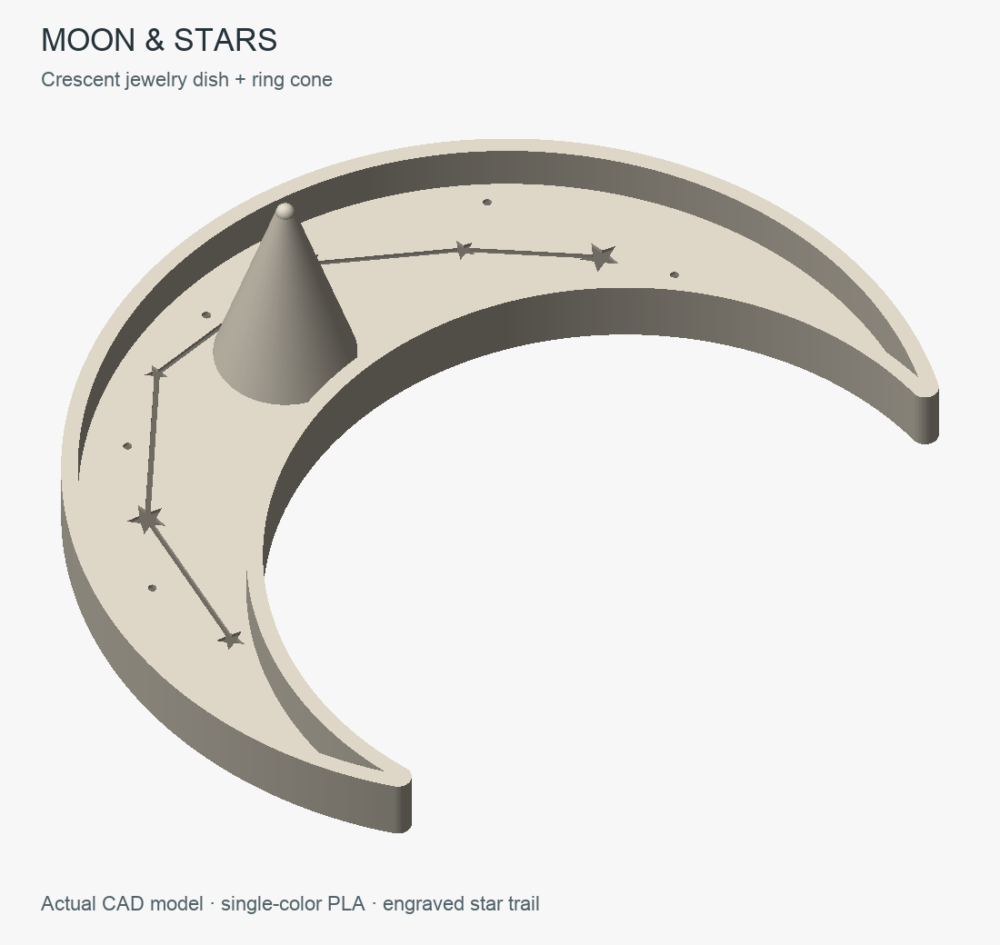

# Snapmaker U1 skill

[](https://skills.sh/rahulbsw/snapmaker-u1-skill/snapmaker-u1)

An Agent Skill for creating parametric 3D designs and preparing meshes for the **Snapmaker U1**, usable with Codex, Claude Code, OpenClaw, Pi and other compatible agents. Core Python workflows support macOS, Windows and Linux; Apple helpers remain optional. Includes local mesh checks, previews, color conversion, guarded Bambu-project conversion and Snapmaker Orca CLI slicing. See [platform setup and limits](references/PLATFORMS.md).



## What works—and what needs setup

- **CAD and mesh preparation:** editable designs, explicit scale/orientation, encoded STL/GLB checks, actual mesh views and offline orbit previews.
- **U1 print planning:** Draft, Normal, Strong and Flexible intent; material/support/plate tradeoffs and actual slice estimates. The CLI adapter currently targets a **0.4 mm U1 nozzle** and never starts a print.
- **Toolpath review:** all-layer extrusion-centerline checks against the resolved build polygon, exclusions and height, plus top/isometric previews of actual sliced supports, brim and model features. Unsupported motion or failed checks prevent slice completion; [scope and standalone use](docs/PRINT_GUIDE.md#toolpath-review).
- **Optional printer check:** read-only local status, temperatures, decoded RFID details and separately labelled configured filament settings, with an explicit physical slot comparison. Uses Python's standard library; no printer controls, uploads or automatic network discovery. [Setup and limits](references/PRINTER_CHECK.md).
- **Color:** source appearance → target regions → native painted 3MF → Orca Full Spectrum matching. Export does not invent calibrated recipes. STL contains no color; an untextured GLB also contains no color to recover.
- **Bambu/MakerWorld:** optional, separately installed converter for editable projects with up to four ordinary logical filaments. Source hashes and mapping reports are preserved; fresh slicing is required.
- **Apple tools:** optional local Vision background removal, Foundation Models intent planning and Object Capture for overlapping real photo sets.
- **Image-to-3D:** optional TripoSR setup, a separately installed Modly app, or an advanced compatible TRELLIS runtime. They can produce candidate geometry; this package does **not** provide reliable identity-preserving portrait reconstruction or Tripo/Meshy parity.

Successful import, generation or slicing is not a completed physical print test. See [feature boundaries](FEATURES.md).

## Install

Install through the [skills.sh CLI](https://skills.sh/docs/cli) (Node.js 22.20 or later):

```sh
npx skills add rahulbsw/snapmaker-u1-skill --skill snapmaker-u1 -a codex
```

Replace `codex` with `claude-code`, `openclaw`, `pi` or `opencode`, or pass several agent names after `--agent`. This installs into the current project. Add `-g` for a global installation. The CLI installs the skill files; set up the Python core dependencies below in the installed folder before using mesh/CAD helpers. Optional AI runtimes and Snapmaker Orca remain separate installations.

For development, clone into a directory of your choice:

```sh
git clone https://github.com/rahulbsw/snapmaker-u1-skill.git
cd snapmaker-u1-skill
```

In the installed skill folder or checkout, create and activate a Python 3.11 environment. On macOS/Linux:

```sh
python3.11 -m venv .venv
source .venv/bin/activate
python -m pip install -r requirements-core.txt
```

On Windows PowerShell, activation is optional; invoke the interpreter directly:

```powershell
py -3.11 -m venv .venv
.\.venv\Scripts\python.exe -m pip install -r requirements-core.txt
```

The examples below use `python` from the activated environment; on Windows substitute `.\.venv\Scripts\python.exe`. Invoke **`$snapmaker-u1`** in Codex, or ask your agent to use the `snapmaker-u1` skill with a text brief or reference images. The skill folder is self-contained; optional apps, neural weights and hardware are installed separately. Restart the agent session if its skill discovery needs refreshing.

`local-runtime.json` is optional and ignored by Git. To configure absolute interpreter/runtime paths or enforce local-only processing, copy `local-runtime.example.json` and replace its example paths. Do not commit that machine-specific copy or credentials.

## Quick start: no neural model required

```sh
# Geometry facts only; this checker uses the Python standard library.
python scripts/u1_mesh_check.py your-model.stl

# Mesh views and a local interactive orbit viewer.
python scripts/u1_preview.py your-model.stl --output-dir outputs/preview --up-axis z

# Preserve aspect ratio, set a height and screen actual exports.
python scripts/u1_prepare.py your-model.stl --output-dir outputs/prepared --height-mm 100 --up-axis z

# Requires the separately installed Snapmaker Orca app and matching PLA spool.
python scripts/u1_slice.py outputs/prepared/prepared.stl --output-dir outputs/slicing --material 'Generic PLA'
```

Outputs include provenance, `toolpath-review.json` and `toolpaths-top.png` / `toolpaths-3d.png` for each distinct G-code artifact. `slice_completed` requires a successful slicer export, passing path checks and generated previews. `slicer_output_completed` separately records native export success. Confirm the **actual** plate, nozzle, spool and layer preview before printing. Single-filament CLI overrides intentionally refuse mixed/calibrated or unrecognized projects.

For an original CAD example, run `python examples/moon-jewelry-dish/build_dish.py`; see [its instructions](examples/moon-jewelry-dish/README.md). It creates local STL/GLB and validation reports, with no cloud service. For Windows/Linux Orca paths, use the [platform-specific slicing examples](references/PLATFORMS.md#snapmaker-orca).

## Optional workflows

| Need | Guide |
|---|---|
| Agent and operating-system setup | [Platforms](references/PLATFORMS.md) |
| Native Apple segmentation/planning | [Apple tools](references/APPLE_NATIVE.md) |
| Reconstruction from overlapping photos | [Apple Object Capture](references/APPLE_CAPTURE.md) |
| TripoSR dependencies and public-weight setup | [Local engine](references/LOCAL_ENGINE.md) |
| Separate Modly app / TripoSG | [Modly](references/MODLY.md) |
| Compatible patched TRELLIS runtime | [Advanced TRELLIS adapter](references/TRELLIS_RUNNER.md) |
| Portrait likeness review | [Image reconstruction](references/IMAGE_TO_3D.md) |
| Source photos and observed/inferred views | [Reference provenance](references/WEB_REFERENCES.md) |
| Native Full Spectrum matching | [Color workflow](references/FULL_SPECTRUM.md) |
| Bambu/MakerWorld project conversion | [Conversion](references/BAMBU_CONVERSION.md) |
| Supports, materials and filament use | [Print guide](docs/PRINT_GUIDE.md) |
| Printer status and loaded physical spools | [Read-only printer check](references/PRINTER_CHECK.md) |

The heavy `requirements-local.txt` is for the optional **TripoSR** route; it is not needed for the basic checker, CAD example or mesh tools. Modly and TRELLIS need their own compatible environments, not a shared blanket dependency install.

## Development

```sh
python -m unittest discover -s tests -v
```

Tests use synthetic inputs and mocked printer HTTP responses; they do not contact a live printer, download model weights, generate a neural mesh or upload files. Optional Torch, native Apple and pinned Bambu-backend checks skip when their dependencies are absent. CI runs the core suite on Linux, Windows and macOS. Native Apple tests require macOS and a suitable Swift SDK.

Private photos, generated jobs, runtimes, weights, local configuration, backups and agent state are excluded by `.gitignore`. The public example contains only original CAD source and its rendered preview; no customer portraits, calibration files or printer G-code are bundled.

## License and attribution

Original skill code, documentation and CAD example are [MIT licensed](LICENSE). Downloaded engines, weights, slicers and the Bambu converter retain their own terms; see [third-party notices](THIRD_PARTY_NOTICES.md). In particular, the optional Bambu conversion backend uses a noncommercial license. This is an independent project, not an official Snapmaker product.

Primary references: [U1 documentation](https://wiki.snapmaker.com/en/snapmaker_u1), [Snapmaker Orca](https://github.com/Snapmaker/OrcaSlicer), [Full Spectrum matching](https://wiki.snapmaker.com/en/snapmaker_orca/color_mixing_match_guide).
